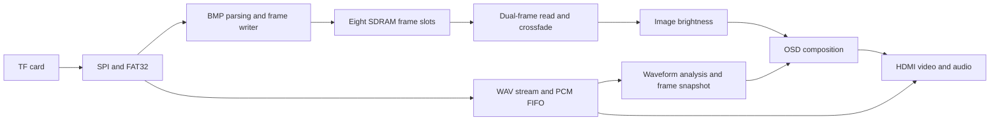
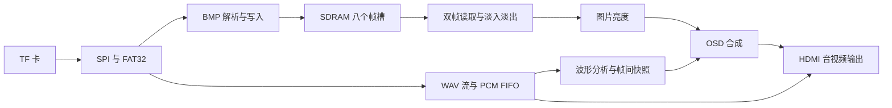

# ABC-project-1

An FPGA-based HDMI multimedia player with eight-image caching, scrolling captions, crossfades, and real audio waveform visualization.

[English](#english) · [简体中文](#简体中文)

## English

### Overview

ABC-project-1 runs on the HX4S20C development board with an Anlogic EG4S20BG256 FPGA. It reads BMP images and PCM WAV audio from a TF card, stores eight display frames in the integrated SDRAM, and outputs the composed picture and audio through HDMI.

The project focuses on responsive image navigation and continuous playback. During startup, each fully loaded image becomes part of a visible preview. After all eight images have been cached and the preview returns to the first image, manual controls and automatic playback become available. Subsequent image changes use SDRAM instead of reading the target BMP again.

### Features

- Eight-image cache: all eight display frames remain in SDRAM after loading. Rapid next/previous button presses can be queued, with up to 32 pending requests.
- Visible startup preview: the sequence is `1 → 2 → 3 → 4 → 5 → 6 → 7 → 8 → 1`. The first image, captions, elapsed timer, and music start together once the first frame is ready.
- Scrolling OSD: a font ROM and multiple Alpha layers render the scrolling team caption and elapsed time. Fractional-pixel scrolling and edge fading soften the text movement.
- Crossfade transitions: the old and new frames are mixed with frame-boundary updates. A transition takes approximately 0.53 s.
- Real audio waveform: the display uses the PCM samples sent to playback. Each column summarizes 160 samples, and 640 columns show approximately 2.13 s of amplitude history.
- Brightness control: nine levels from 50% to 150%, in 12.5% steps. Only the image brightness changes; the OSD and waveform keep their own appearance.
- Standalone operation: the integrated design has been programmed into board Flash and verified to start after a power cycle.

The three completed extension areas are scrolling OSD, crossfade transitions, and audio waveform visualization. The real-time adjustment extension is partially implemented through brightness control.

### Image size and output resolution

| Item | Configuration |
| --- | --- |
| Input images | Eight `640×480`, 24-bit uncompressed BMP files |
| Complete HDMI frame | `800×600`, approximately `60.32 Hz` |
| Image placement | Centered, with 80 pixels on each side and 60 pixels above and below |
| Top area | Scrolling caption and elapsed time |
| Bottom area | Audio waveform |
| Internal image format | RGB444, with two pixels packed into each 32-bit SDRAM word |
| Audio | `48 kHz`, 16-bit mono PCM WAV, duplicated to HDMI left/right channels |

800×600 describes the complete output canvas, including the surrounding areas. The source image remains 640×480 and keeps its 4:3 aspect ratio. A connected display may apply its own scaling, so use an aspect-preserving display mode when appropriate.

### Controls

Controls become available after the startup preview returns to image 1 and the final crossfade completes. Inputs during the preview are not queued; release a held button before pressing it again.

| Control | Function |
| --- | --- |
| K1 | Next image, wrapping from image 8 to image 1 |
| K2 | Previous image, wrapping from image 1 to image 8 |
| K3 | Increase image brightness by 12.5% |
| K4 | Decrease image brightness by 12.5% |
| SW1 | Automatic playback with a stable hold of 1 s |
| SW2 | Automatic playback with a stable hold of 3 s |
| SW3 | Automatic playback with a stable hold of 5 s |
| SW4 | Automatic playback with a stable hold of 8 s |
| All SW switches off | Manual mode |

Select one timing switch at a time. If multiple switches are active, the priority is `SW1 > SW2 > SW3 > SW4`. Switch inputs are active-low.

The selected interval excludes the crossfade. For example, the 3 s setting gives approximately 3 s of stable display followed by a 0.53 s transition. Manual next/previous controls also work in automatic mode; the stable-hold timer restarts after the requested switch completes.

Buttons generate one event per press, without automatic repetition while held. Brightness defaults to 100%, persists across image changes, and resets on power-up.

### TF card preparation

Use a FAT32 card and place these files directly in its root directory:

```text
TF card root/
├── IMAGE1.BMP
├── IMAGE2.BMP
├── IMAGE3.BMP
├── IMAGE4.BMP
├── IMAGE5.BMP
├── IMAGE6.BMP
├── IMAGE7.BMP
├── IMAGE8.BMP
└── MUSIC.WAV
```

- Images: 640×480, 24-bit RGB, uncompressed BMP (`BI_RGB`). Use the supplied standard BMP layout with a 54-byte header and bottom-up rows.
- Audio: 48 kHz, 16-bit mono PCM WAV, using a standard 44-byte header. Convert other audio formats before copying them to the card.
- Keep the filenames exactly as shown. The current design expects all eight images.
- After replacing card contents, restart the board to reload the image cache.

If a required image is missing or invalid, the preview cannot finish and normal controls remain locked. The board may keep displaying the last valid preview image while the timer, caption, and audio continue. Check the file count, filenames, and formats, then restart.

### Design



The cache evolved from double buffering, to current/previous/next triple buffering, and finally to eight resident images. Two RGB444 pixels occupy one 32-bit word. An `800×600` display frame therefore uses 240,000 words, or 960,000 bytes; eight frames use 7,680,000 bytes of the available 8,388,608-byte SDRAM.

This packing reduces color precision relative to the RGB24 input. It makes the full cache practical while leaving bandwidth for reading both frames during a crossfade. Audio is streamed through a separate 4,096-sample PCM FIFO rather than storing the entire track in SDRAM.

Integration separates pixel acceptance from completed SDRAM writes. A frame becomes valid only after source completion, writer completion, and a successful status. Complete-line reads, asynchronous FIFOs, frame-boundary updates, and read/write arbitration keep the display path supplied while other work proceeds.

### Build and run

1. Prepare the TF card and connect an HDMI display with audio playback support.
2. Open `ABC-project-1.al` in Anlogic Tang Dynasty. The project records TD version 6.2.168116, target device EG4S20BG256, and top module `abc_hdmi_top`.
3. Check project paths and tool dependencies for your local checkout. The original project file contains an absolute creation path.
4. Run synthesis, implementation, and bitstream generation, or use the supplied `ABC-project-1.bit` when included with your checkout.
5. Download the bitstream for a trial run. Program board configuration Flash for persistent standalone startup.
6. Wait for the eight-image preview to return to image 1, then use the buttons or timing switches.

The Windows helper scripts `rebuild_bit.cmd` and `verify_all.cmd` call the build and verification scripts in `ab_verify/` through `pwsh`. Their local tool paths and dependencies must be available before use.

### Verification and current scope

| Evidence | Result |
| --- | --- |
| Integrated image simulation | 456 frames and 219,360,000 checked active pixels |
| Integrated audio simulation | 363,647 ordered reference PCM frames, with no playback underrun in the tested interval |
| HDMI output simulation | 4,320,000 checked pixels, 7,923 audio packets, and 138 ACR packets |
| LUT use | 15,990 / 19,600, or 81.58% |
| 9 Kb BRAM use | 47 / 64, or 73.44% |
| DSP use | 18 / 29, or 62.07% |
| Worst setup / hold slack | +0.159 ns / +0.003 ns |

Simulation counts describe their tested windows. On-board operation and Flash power-cycle startup have also been confirmed. These results do not constitute a full environmental or long-duration reliability qualification.

The current implementation uses fixed image dimensions and eight fixed filenames. The visualizer is a time-domain waveform, not an FFT spectrum. Contrast adjustment, an on-screen brightness value, and hardware scaling of arbitrary image sizes remain future work.

### Project entry points

| Path | Purpose |
| --- | --- |
| `ABC-project-1.al` | Tang Dynasty project |
| `ABC-project-1.bit` | Integrated FPGA bitstream |
| `rtl/` | TF/SPI access, FAT32/BMP parsing, and media streaming |
| `RTL_1/bridge/` | Top-level integration, cache control, and SDRAM writing |
| `RTL_1/a_core/` | Frame reads, display timing, OSD, and brightness |
| `RTL_1/abc_audio/` | PCM buffering/playback, waveform analysis, and HDMI audio |
| `ab_verify/` | Simulation, build, and verification helpers |

The design builds on the board's reference examples and low-level interface modules, with project-specific integration, caching, presentation control, and audio visualization.

---

## 简体中文

### 项目简介

ABC-project-1 是一套运行在 HX4S20C 开发板上的 FPGA HDMI 多媒体播放系统，核心器件为 安路 EG4S20BG256。系统从 TF 卡读取 BMP 图片和 PCM WAV 音频，将八幅显示帧缓存在集成 SDRAM 中，再通过 HDMI 输出合成后的画面与声音。

项目重点是改善图片切换响应，并保持连续播放。启动时，完整加载一张就预览一张；八图全部缓存并返回第一张后，才开放手动操作和自动轮播。此后的切图直接访问 SDRAM，无需再次从 TF 卡读取目标 BMP。

### 功能亮点

- 八图常驻缓存：加载完成后保留八幅显示帧，前后切图不再等待读卡；连续点击可按顺序排队，最多保留 32 次请求。
- 可见的启动预览：固定执行 `1 → 2 → 3 → 4 → 5 → 6 → 7 → 8 → 1`。首图准备完成后，画面、字幕、运行计时和音乐同步开始。
- 滚动字幕与 OSD：利用字模 ROM、多层 Alpha 混合、分数像素滚动和边缘渐隐，显示组名及运行时间。
- 淡入淡出：新旧两帧逐帧混合，在帧边界更新，单次转场约 0.53 s。
- 真实音频波形：由播放端 PCM 数据生成，每 160 个样本形成一列包络，640 列覆盖约 2.13 s 历史。
- 图片亮度调节：提供 50%～150% 共九档亮度，步进 12.5%；字幕和波形不随图片一起变暗。
- 脱离电脑运行：基础播放与扩展功能集成在同一程序中，已确认 Flash 固化后断电重新上电可以自动运行。

目前完整实现的三个扩展方向为：滚动字幕、淡入淡出、音频波形可视化。实时调节方向通过亮度控制实现了一部分。

### 图片尺寸与输出分辨率

| 项目 | 当前配置 |
| --- | --- |
| 输入图片 | 八幅 `640×480`、24 位非压缩 BMP |
| 完整 HDMI 画面 | `800×600`，约 `60.32 Hz` |
| 图片位置 | 居中，左右各留 80 像素，上下各留 60 像素 |
| 顶部区域 | 滚动组名和运行时间 |
| 底部区域 | 音频波形 |
| 内部缓存格式 | RGB444，每两个像素打包至一个 32 位 SDRAM 字 |
| 音频 | `48 kHz`、16 位单声道 PCM WAV，复制为 HDMI 左右声道 |

800×600 指包含四周留边的完整输出画面。中间图片仍为 640×480，保持 4∶3 原比例。显示终端可能进行二次缩放，使用白板或宽屏显示器时，应选择保持比例的显示方式。

### 按键与拨码

启动预览返回第一张、最后一次淡入淡出完成后，操作才生效。预览期间的按键不会排队；如果一直按住某键，需要先松开再按。

| 控件 | 功能 |
| --- | --- |
| K1 | 下一张，第八张之后回到第一张 |
| K2 | 上一张，第一张之前回到第八张 |
| K3 | 图片亮度增加 12.5% |
| K4 | 图片亮度降低 12.5% |
| SW1 | 自动轮播，稳定停留 1 s |
| SW2 | 自动轮播，稳定停留 3 s |
| SW3 | 自动轮播，稳定停留 5 s |
| SW4 | 自动轮播，稳定停留 8 s |
| 全部 SW 关闭 | 手动模式 |

每次选择一个轮播档位。多档同时有效时，优先级为 `SW1 > SW2 > SW3 > SW4`，拨码输入为低有效。

设定时间不包含淡入淡出。例如 3 s 档会稳定展示约 3 s，再进行约 0.53 s 的转场。自动模式下也可手动前后切图，切换完成后重新计算稳定停留时间。

每次按下只产生一次操作，长按不连续触发。亮度默认 100%，切图时保留，重新上电后恢复默认。

### TF 卡准备

使用 FAT32 格式，将以下文件直接放在 TF 卡根目录：

```text
TF 卡根目录/
├── IMAGE1.BMP
├── IMAGE2.BMP
├── IMAGE3.BMP
├── IMAGE4.BMP
├── IMAGE5.BMP
├── IMAGE6.BMP
├── IMAGE7.BMP
├── IMAGE8.BMP
└── MUSIC.WAV
```

- 图片规格为 640×480、24 位 RGB、非压缩 BMP（`BI_RGB`），采用配套素材的标准 54 字节文件头与自底向上行序。
- 音频规格为 48 kHz、16 位单声道 PCM WAV，采用标准 44 字节文件头。其他音频格式需提前转换。
- 文件名按上述格式保存，当前程序要求八张图全部存在且格式正确。
- 更换素材后重新上电，才能更新 SDRAM 图片缓存。

缺图或格式错误会导致预览无法结束，正常按键仍处于锁定状态。此时可能停在最后一张有效图片，而字幕、时间和音乐仍在运行。请检查文件数量、名称和格式，修正后重新上电。

### 系统设计



缓存方案先后经历了双缓冲、当前／前一张／后一张三缓冲、八图常驻。每两个 RGB444 像素占一个 32 位字，因此一帧 `800×600` 画面占 240,000 字，即 960,000 字节；八帧共占 7,680,000 字节，小于 SDRAM 的 8,388,608 字节。

这一打包方式相对 RGB24 输入降低了颜色精度，换取完整图库常驻的容量及转场时读取两帧的带宽。音乐通过独立的 4096 样本 PCM FIFO 流式播放，不把整首音乐存入图片 SDRAM。

模块对接时，将像素接收确认与 SDRAM 实际写完分开处理。只有源数据结束、写入完成且状态成功，才发布有效帧；显示侧通过整行读取、异步 FIFO、帧边界提交和读写仲裁持续取得像素。

### 编译与运行

1. 准备 TF 卡，连接支持音视频播放的 HDMI 显示终端。
2. 使用安路 Tang Dynasty 打开 `ABC-project-1.al`。工程记录的 TD 版本为 6.2.168116，目标器件为 EG4S20BG256，顶层模块为 `abc_hdmi_top`。
3. 按本机目录检查工程路径与依赖。工程文件保留了原创建位置的绝对路径。
4. 执行综合、实现和位流生成；如果下载的工程包含 `ABC-project-1.bit`，也可使用配套位流。
5. 先下载验证功能，需要独立上电运行时，再写入板载配置 Flash。
6. 等待八图预览返回第一张，即可操作按键或选择自动轮播档位。

Windows 辅助入口 `rebuild_bit.cmd` 和 `verify_all.cmd` 通过 `pwsh` 调用 `ab_verify/` 中的编译与验证脚本，使用前需要配置相应工具路径和依赖。

### 验证结果与当前范围

| 验证项目 | 结果 |
| --- | --- |
| 图像集成仿真 | 456 帧，核对 219,360,000 个有效像素 |
| 音频集成仿真 | 核对 363,647 个有序参考 PCM 帧，测试区间无播放欠载 |
| HDMI 输出仿真 | 核对 4,320,000 个像素、7,923 个音频包和 138 个 ACR 包 |
| LUT | 15,990 / 19,600，81.58% |
| 9 Kb BRAM | 47 / 64，73.44% |
| DSP | 18 / 29，62.07% |
| 最差建立／保持裕量 | +0.159 ns / +0.003 ns |

仿真数字对应各自的测试窗口。项目也已完成上板功能验证和 Flash 断电启动确认；这些结果不等同于全环境或长期可靠性测试。

当前版本采用固定图片规格和八个固定文件名，音频显示为时域波形。对比度调节、亮度参数数值 OSD，以及任意尺寸图片的硬件缩放仍属于后续扩展内容。

### 主要工程入口

| 路径 | 用途 |
| --- | --- |
| `ABC-project-1.al` | Tang Dynasty 工程 |
| `ABC-project-1.bit` | 综合功能位流 |
| `rtl/` | TF／SPI、FAT32／BMP 解析及媒体读取 |
| `RTL_1/bridge/` | 顶层集成、缓存控制与 SDRAM 写入 |
| `RTL_1/a_core/` | 帧读取、显示时序、OSD 与亮度 |
| `RTL_1/abc_audio/` | PCM 缓冲播放、波形分析及 HDMI 音频 |
| `ab_verify/` | 仿真、编译与验证辅助脚本 |

项目在板卡参考例程及底层接口模块的基础上，完成了面向本作品的系统集成、缓存管理、展示控制和音频可视化。
